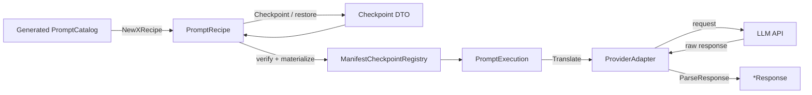

# prompty

[](https://pkg.go.dev/github.com/skosovsky/prompty)

**TL;DR** — prompty is a library for prompt management, templating, and unified interaction with LLMs in Go. It supports loading prompts from files, Git, or HTTP and works with multiple backends (OpenAI, Anthropic, Gemini, Ollama) without locking you to a single vendor.

Current guarantees and ownership rules are indexed in [Current contracts](docs/README.md).

## Modules and installation

The project is split into multiple Go modules. Install only what you need:

| Layer      | Package                                 | Install                                                  |
| ---------- | --------------------------------------- | -------------------------------------------------------- |
| Core       | prompty (templates, registries in-tree) | `go get github.com/skosovsky/prompty`                    |
| Adapters   | OpenAI                                  | `go get github.com/skosovsky/prompty/adapter/openai`     |
|            | Gemini                                  | `go get github.com/skosovsky/prompty/adapter/gemini`     |
|            | Anthropic                               | `go get github.com/skosovsky/prompty/adapter/anthropic`  |
|            | Ollama                                  | `go get github.com/skosovsky/prompty/adapter/ollama`     |
| Registries | Git (remote)                            | `go get github.com/skosovsky/prompty/remoteregistry/git` |

`fileregistry` and `embedregistry` are part of the core module (`github.com/skosovsky/prompty`).

Full caller-owned dispatch and pure batch admission are documented in [Host tool dispatch](docs/host-tool-dispatch.md), with an [optional executable recipe](examples/host_dispatch/README.md).

Tool scope, cancellation, partial results and the breaking handler/wire API are documented in [Tool execution contract](docs/tool-execution-contract.md).

Deterministic context budgeting, protected turns/exchanges and the breaking extension API are documented in [Execution budgeting](ext/truncate/README.md) and [budget middleware](middleware/contextx/README.md).

## Quick Start

Start with your own input type, a template and the checked adapter client. No generated package or manifest is required. The [complete example](examples/basic_chat/direct/main.go) is tested with a local SDK HTTP fixture; running it against a provider requires your key and chosen model.

Requires Go 1.27.1 or newer.

```bash
OPENAI_MODEL=<host-selected-model> OPENAI_API_KEY=<key> go run ./examples/basic_chat/direct
```

```go
// Direct BYOT example. No manifest or generator is required.
// Run: OPENAI_MODEL=<host-selected-model> OPENAI_API_KEY=<key> go run ./examples/basic_chat/direct
package main

import (
	"context"
	"fmt"
	"log"
	"os"

	openaisdk "github.com/openai/openai-go/v3"
	"github.com/openai/openai-go/v3/option"

	"github.com/skosovsky/prompty"
	"github.com/skosovsky/prompty/adapter"
	openaiadapter "github.com/skosovsky/prompty/adapter/openai"
)

type Question struct {
	Text string `prompt:"question"`
}

func materialize(ctx context.Context, question Question) (*prompty.PromptExecution, error) {
	tpl, err := prompty.NewChatPromptTemplate([]prompty.MessageTemplate{
		{Role: prompty.RoleSystem, Content: prompty.TextContent("Answer briefly.")},
		{Role: prompty.RoleUser, Content: prompty.TextContent("{{ .Input.question }}")},
	})
	if err != nil {
		return nil, err
	}
	input, err := prompty.PlanInputFrom(question)
	if err != nil {
		return nil, err
	}
	plan, err := prompty.NewRenderPlanFromPlanInput(tpl, input)
	if err != nil {
		return nil, err
	}
	return plan.Execute(ctx)
}

func main() {
	key, model := os.Getenv("OPENAI_API_KEY"), os.Getenv("OPENAI_MODEL")
	if key == "" || model == "" {
		log.Fatal("set OPENAI_API_KEY and OPENAI_MODEL to a host-selected model")
	}
	ctx := context.Background()
	execution, err := materialize(ctx, Question{Text: "What is 2+2?"})
	if err != nil {
		log.Fatal(err)
	}
	const endpoint = "https://api.openai.com/v1"
	sdk := openaisdk.NewClient(option.WithAPIKey(key), option.WithBaseURL(endpoint))
	client := adapter.NewClient(
		openaiadapter.New(
			openaiadapter.WithClient(&sdk),
			openaiadapter.WithModel(model),
			openaiadapter.WithProfiles(endpoint),
		),
	)
	response, err := client.Execute(ctx, execution)
	if err != nil {
		log.Fatal(err)
	}
	if response.Outcome != prompty.OutcomeCompleted {
		log.Fatal("provider did not complete")
	}
	text, err := response.StrictText()
	if err != nil {
		log.Fatal(err)
	}
	fmt.Println(text)
}
```

Use `prompty.SimpleChat(...)`, templates or your own `PromptExecution` builder when that fits your application. If an execution requests tools, constrained output, media, native streaming or another required guarantee, supply caller-verified endpoint/model profiles with `WithProfiles`; unknown required support fails before dispatch. Profile configuration must match the injected SDK transport and is not a model support catalog.

### Optional manifest/codegen workflow

The repository contains a complete reproducible [config](cmd/prompty-gen/testdata/prompty.yaml), [manifests and inputs](cmd/prompty-gen/testdata/prompts), and [typed consumer](cmd/prompty-gen/testdata/gen_out/prompt_index_test.go):

```bash
(cd cmd/prompty-gen && GOWORK=off go run . -config testdata/prompty.yaml generate)
(cd cmd/prompty-gen && GOWORK=off go test -race ./testdata/gen_out)
make test-e2e
```

The codegen e2e check regenerates fixtures in a temporary directory, compares
their contents and file set with the checked-in output, then tests the generated
consumer. A mismatch fails the check without modifying the working tree.

Use generated recipe/checkpoint APIs when source snapshots and serialized typed input fit your application. The [generator guide](cmd/prompty-gen/README.md) explains caller-owned registry/config paths and restore policy. Model calls remain explicit.

## Main abstractions

- **PromptRecipe / ManifestDescriptor** — JSON-safe application checkpoint surface. A recipe stores typed input, optional late input, runtime compose values, and `{ID, Digest}`; restore it with `PromptRecipeFromCheckpoint` / generated `NewXRecipeFromCheckpoint`, then execute against a `ManifestCheckpointRegistry`.
- **Generated PromptCatalog / PromptIndex** — typed recipe constructors and a static id index for known prompts. Use generated recipe APIs for optional manifest-backed materialization; use `PromptIndex.NewRecipeFromJSON` only for explicit serialized payload dispatch.
- **Registry** — supplies plans from files, embed, remote or caller-owned BYOT materialization. Strong source verification belongs to the ManifestCheckpointRegistry/capture ports. Generated recipes capture one source snapshot, verify its identity, and build the plan from the same bytes. Direct `Registry.Plan(ctx, id, input)` is a low-level API for advanced integrations.
- **Adapter** — maps `PromptExecution` to a provider request and parses a full `Response`. Checked path: `adapter.NewClient(providerAdapter)` → `client.Execute(ctx, exec)`. Low-level `Translate` → SDK `Execute` → `ParseResponse` does not provide checked profile/schema guarantees. Streaming uses `client.ExecuteStream(ctx, exec, mode)` and a lazy, single-use handle; native adapters implement `StreamerAdapter.StreamEvents`. Runtime metadata and token budgets live behind `adapter.NewRuntimeClient(providerAdapter)`; `adapter.EstimateTokens(estimator, exec)` returns `ErrNoTokenEstimator` without a provider estimator.
- **Templating** — `ChatPromptTemplate` is built from message templates and optional tools. Generated recipes materialize it into `PromptExecution` at execution time. Template context is explicit: `{{ .Input.<field> }}` and `{{ .LateVars.<field> }}`. Registries load manifests (JSON or YAML), expand declarative `imports`/`layers`, and support `WithPartials` for shared `{{ template "name" }}` partials. Template functions (funcmaps) include `truncate_chars`, `truncate_tokens`, `render_tools_as_xml`, `render_tools_as_json`, `escapeXML`, and `randomHex`.

Optional manifest pipeline: **generated recipe** → **checkpoint/restore** → **captured source verification + materialization** → **PromptExecution** → **Adapter** → provider API.

## Features

- **Domain model**: `ContentPart` (text/media/tool call/result), `ChatMessage`, `ToolDefinition`, `PromptExecution` with metadata; open-ended roles in manifests (validation in adapters). `CachePolicy` declares an implicit-prefix or block-marker mechanism, advisory/required mode and provider-scoped controls on a message or part (`cache_policy` in manifests). Checked execution returns disposition diagnostics, not a cache-hit promise; required unknown/unsupported controls fail before dispatch. **Execution-level provider knobs:** use `PromptExecution.ModelOptions.ProviderSettings` (e.g. `gemini_search_grounding` for Gemini).
- **Media**: `exec.ResolvedMedia(ctx, fetcher)` returns a cloned execution with `MediaPart.Data` filled via a `Fetcher` (e.g. `mediafetch.DefaultFetcher{}`); use it before `Translate` for adapters that require inline data (for example Ollama, and Anthropic for unsupported URL media shapes). OpenAI and Gemini accept URL natively.
- **Templating**: `text/template` with fail-fast validation, `PartialVariables`, optional messages, chat history splicing. **DRY:** registries support `WithPartials(pattern)` so manifests can use `{{ template "name" }}` with shared partials (e.g. `_partials/*.tmpl`).
- **Template functions**: `truncate_chars`, `truncate_tokens`, `render_tools_as_xml` / `render_tools_as_json` for tool injection.
- **Registries**: load manifests from filesystem (`fileregistry`), embed (`embedregistry`), or remote HTTP/Git (`remoteregistry`). Remote cache is explicit via `remoteregistry.WithCache(...)` (unlimited entries) or `remoteregistry.WithCacheLimit(base, ttl, maxEntries)` (positive FIFO entry limit). Expired entries are cleaned on material lookup/publication; idle caches have no cleanup worker. See [retention contract](docs/performance-memory-retention.md).
- **Adapters**: map `PromptExecution` to provider request types (OpenAI, Anthropic, Gemini, Ollama); return ordered content, usage presence, outcome, annotations, scoped continuation state and checked diagnostics. `Annotations` has explicit content-part associations; `MessageAnnotations` carries whole-message metadata without invented part indices. Stream message metadata is an ordered update sequence, including late updates after finish, not independent merged snapshots. Both survive history/wire and remain subject to host redaction. Tool result is multimodal: `ToolResultPart.Content` is `[]ContentPart` (text and/or images). Adapters that do not support media in tool results return `ErrUnsupportedContentType` when `MediaPart` is present in `ToolResultPart.Content`.
- **Exchange fidelity**: exact Gemini arguments/IDs across observed IO and SDK serialization; Ollama thinking preserved in continuation. ID-less checked history requires confirmed name correlation, and unsupported error-result/interleaving shapes fail explicitly. See the [provider exchange contract](docs/provider-exchange-contract.md).
- **Observability**: `PromptMetadata` (ID, version, description, tags, environment) on every execution.

## Registries

| Package                                       | Description                                                                                                                                                                 |
| --------------------------------------------- | --------------------------------------------------------------------------------------------------------------------------------------------------------------------------- |
| `github.com/skosovsky/prompty/fileregistry`   | Load manifests (JSON or YAML via WithParser) from a directory; lazy load with cache; `Reload()` to clear cache; `WithPartials(relativePattern)` for `{{ template "name" }}` |
| `github.com/skosovsky/prompty/embedregistry`  | Load from `embed.FS` at build time; source bytes sealed at construction; `WithPartials(pattern)` for shared partials                                                                       |
| `github.com/skosovsky/prompty/remoteregistry` | Fetch via `Fetcher` (HTTP or Git); explicit cache via `WithCache`; `Close()` for resource cleanup                                                                           |

All three registries also implement optional `prompty.Lister` (`List(ctx)`), `prompty.Statter` (`Stat(ctx, id)`), and `prompty.ManifestResolver` (`ResolveManifest(ctx, id)` — metadata only, no template AST). When you have a variable of type `prompty.Registry` and need list/stat/descriptor APIs, use a type assertion.

With `WithEnvironment(env)`, only `{name}.{env}.json|yaml|yml` are resolved (strict, no fallback to base `{name}`). Without env, `{name}.json|yaml|yml` are tried. Name must not contain `':'`.

## Adapters

| Package                                          | Translate result                  | Notes                                                                                      |
| ------------------------------------------------ | --------------------------------- | ------------------------------------------------------------------------------------------ |
| `github.com/skosovsky/prompty/adapter/openai`    | `*openai.ChatCompletionNewParams` | Tools, MIME-routed media (image/audio/file), tool calls                                    |
| `github.com/skosovsky/prompty/adapter/anthropic` | `*anthropic.MessageNewParams`     | `image/*` and PDF media (base64 or URL), `text/plain` document blocks (base64), tool calls |
| `github.com/skosovsky/prompty/adapter/gemini`    | `*gemini.Request`                 | Default model + overrides (`WithModel`, `ModelOptions.Model`); generic media URI/bytes     |
| `github.com/skosovsky/prompty/adapter/ollama`    | `*api.ChatRequest`                | Native Ollama tools                                                                        |

Each adapter implements `Translate(exec) (Req, error)` where Req is the provider request type; `ParseResponse(raw)` returns `*prompty.Response`; use `resp.StrictText()` for fail-closed plain text. `PromptExecution.ModelOptions` carries typed model overrides such as `Model`, `Temperature`, `MaxTokens`, `TopP`, and `Stop`. **Tool result:** `ToolResultPart.Content` is `[]ContentPart` (multimodal). Adapters that do not support media in tool results return `adapter.ErrUnsupportedContentType` when `MediaPart` is present. **Media:** OpenAI and Gemini can map URL media natively for supported types; Anthropic supports URL inputs for `image/*` and `application/pdf`; Ollama requires resolved inline images. Where the target mapping requires inline image data, call `exec.ResolvedMedia(ctx, fetcher)` explicitly; resolving a URL does not implement an unsupported MIME, role or tool-result shape. Media downloading is an explicit caller-owned step; `mediafetch.DefaultFetcher` provides an injectable HTTPS/image fetcher, not arbitrary document resolution or a host egress policy.

## Provider settings

Use `model_options.provider_settings` for vendor-specific knobs. The core keeps this map as-is in `ModelOptions.ProviderSettings`; provider key mapping lives in adapters.

Clean break contract: vendor keys must be inside `provider_settings`. Unknown top-level keys in `model_options` are rejected with a parse error.

```yaml
model_options:
  model: caller-verified-model
  provider_settings:
    reasoning_effort: low
    seed: 42
```

Supported `provider_settings` keys:

- OpenAI Chat: `presence_penalty`, `frequency_penalty`, `seed`, `logprobs`, `top_logprobs`, `reasoning_effort`; separate Responses: `reasoning_effort`, `reasoning_summary`
- Gemini: `stream_function_call_arguments` (Vertex native only), `top_k`, `presence_penalty`, `frequency_penalty`, `stop_sequences`, `thinking`, `thinking_budget`, `thinking_level`, `gemini_search_grounding`
- Anthropic: `top_k`, `stop_sequences`, `thinking_mode`, `thinking_budget`, `thinking_visibility`, `reasoning_effort`
- Ollama: `top_k`, `seed`, `num_ctx`, `repeat_penalty`, `think` (top-level native thinking control)

Provider settings validation is fail-closed: unknown keys or invalid values return `adapter.ErrInvalidProviderSettings` (no silent ignore).

Reasoning settings additionally require a caller-owned `CapabilityProfile.ModelOptionsSchema` for the effective endpoint/model on checked execution. It validates the full `ModelOptions` object and allowed combinations; absent knowledge is unknown and fails before dispatch. Declared schema/resources are local or explicitly injected, never fetched implicitly. SDK mappings are not a claim that all models support the listed settings. See [migration](docs/migration.md) for current clear-break contracts and [task37 migration](docs/task37/migration.md) for earlier explicit modes and the removed OpenAI model-name heuristics.

## Architecture



Pipeline: **PromptCatalog.NewXRecipe(...)** → **recipe.Checkpoint()/restore** → **recipe.ExecuteWithContract(...)** → **PromptExecution** → **Adapter** → LLM API. Direct `Registry.Plan(...)` remains available as an advanced low-level path.

## Checked execution and streaming

Core contracts do not own model routing, retries, agent loops, storage, IAM or scheduling. Inject profiles, validators, SDK transports, media fetchers and optional capture ports. Profiles describe the effective provider/endpoint/model with provenance; an override cannot implement an absent native stream or state port.

Output/tool definitions carry an optional `Dialect`, preserved by clone and execution wire. Empty selects `SchemaDialect2020`; set `SchemaDialect7` explicitly for a schema declaring that dialect. Checked preparation and structured/tool helpers reject incompatible declarations or unavailable validation before dispatch. The runtime validator port is not persisted; rebind it after restore when using explicit resources or application-specific validation. Schema validation precedes domain `Validate()` and is not replaced by successful Go decoding.

Final source validation separates `ErrSchemaJSONDecode` (invalid/truncated/multiple documents) from `ErrSchemaMismatch` (valid JSON violating constraints). Invalid-document errors do not become repairable `ValidationError` or executor domain feedback. Incremental syntax remains `ErrStructuredStream`; provider refusal/incomplete remain outcome errors. See [current schema/data contract](docs/schema-data-contract.md) and [historical task37 schema evidence](docs/task37/schema-conformance.md).

```go
stream := client.ExecuteStream(ctx, exec, prompty.StreamNative)
defer stream.Close()
for event, err := range stream.Events() {
    if err != nil {
        break // partial content/usage/error remain available through Status
    }
    if event.Kind == prompty.StreamTerminal {
        // This is lifecycle completion, unlike a provider finish marker.
    }
}
status := stream.Status()
_ = status // inspect State, Err and Result even after early consumer stop
```

Choose `StreamBuffered` explicitly for a synchronous request exposed through the stream lifecycle; it cannot satisfy native requirements. OpenAI, Anthropic, Gemini and Ollama adapters have native transports and offline protocol fixtures; endpoint/model support remains caller-owned. Gemini Vertex signed incremental arguments retain verified source ordering/state; Developer API incremental arguments remain unsupported. The [capability matrix](docs/provider-capability-matrix.md) links implemented operations and offline fixtures. No automatic replay occurs after partial output.

Custom native sources use `ResponseChunk.StateUpdates` to explicitly replace
opaque state for the same source-proven logical tool call. Bind each update to
the current frame's tool part and preserve scope/codec/required/expiry semantics.
Ordinary `ProviderState` remains append-only; a changed state-bound part without
an explicit update fails. Final `Result.ProviderState` retains the latest
accepted binding, while failed/canceled status retains partial state. The core
never interprets signatures or certifies a producer's provider payload. See the
[executable update example](stream_state_update_example_test.go).

`event.Identity.MessageID` identifies the local handle, not a provider request or physical attempt. `PartIDs` references each frame's logical content parts; in status/terminal it aligns with `Result.Content`, including repeated text-fragment references and materialized tool calls. Custom sources declare these references explicitly; missing/conflicting references fail with `ErrStreamProtocol`. Native and buffered canonical capture preserve them. Middleware attaches lazy observation to the original handle through `ObserveLifecycle`, retaining cancellation/finalizers/capture rather than reassembling a second stream. See the [stream migration contract](docs/task37/migration.md).

The [executable SDK/local-SSE example](adapter/openai/checked_example_test.go) demonstrates checked profile binding, trailing usage, response persistence and continuation without a paid provider request.

Read `Response.Outcome` before interpreting text as success, and `Usage.Known`/`Availability()` before interpreting zero counters. Save through `MarshalResponse` with explicit `WirePolicy`, restore through `DecodeResponseJSON`, and build continuation through `AssistantMessage` rather than copying Content alone. Required opaque state omitted for logging cannot be reused as a continuation checkpoint.

Message annotations may carry provider continuation data without an artificial content part. `MessageAnnotation.Scope` binds metadata to a provider/endpoint/model (or declared model family); `Required:true` requires that scope and an implemented annotation mapping on the receiving adapter. Checked execution verifies profile guarantees and calls the provider state validator even when there is no `PartState`. `StateOmit` removes scoped annotations and marks continuation unavailable when required data was removed. Unscoped optional metadata remains caller-owned; core never decodes provider annotation payloads.

Strict schema fidelity either preserves the original contract or fails before dispatch. Explicit lowering needs named permissions and final original-schema validation; JSON decode and provisional stream items are not that validation. Local tool helpers validate the whole execution-scoped batch before any handler. Capture is optional and host-projected; SDK JSON is semantic capture, not HTTP bytes or physical-attempt evidence. Request cache controls describe disposition, not hits or cache resource lifecycle.

## Migration Notes

This change is a clear break: old iterator/IsFinished semantics, adjacency-based tool assembly, Type-only cache hints and implicit synthetic structured-output tools are removed. No compatibility bridge or lossy legacy-wire restore is supplied. See the [current clear-break migration](docs/migration.md) and [capability matrix](docs/provider-capability-matrix.md). The [task37 contracts](docs/task37/contracts.md) and [release/issue closeout checklist](docs/task37/release-closeout.md) retain historical checkpoint evidence, not a claim about current live support.

Regression gates: `make lint` and `make test` across all modules, including race checks and generator fixtures.

**Checkpoint ops:** compose manifests must list only resolvable import ids for `RecommendManifestDescriptor` / `VerifyManifestDescriptor` (all declared imports, including inactive conditional branches). **Source caching:** file and TTL registries retain whole immutable source bundles, including composition and partials. Reload/expiry/eviction selects a new generation; cache hits do not read current source. See the [source snapshot contract](docs/source-snapshot-contract.md).

## Recipe-First Runtime

```go
func buildExecution(ctx context.Context) (*prompty.PromptExecution, error) {
	reg, err := fileregistry.New("./prompts", fileregistry.WithParser(yaml.New()))
	if err != nil {
		return nil, err
	}

	catalog := prompts.NewPromptCatalog(reg)
	recipe, err := catalog.NewSupportAgentRecipe(ctx, prompts.SupportAgentInput{
		UserQuery: "Where is my order?",
	})
	if err != nil {
		return nil, err
	}

	checkpoint, err := recipe.Checkpoint() // JSON-safe DTO for storage.
	if err != nil {
		return nil, err
	}
	restored, err := prompts.NewSupportAgentRecipeFromCheckpoint(checkpoint)
	if err != nil {
		return nil, err
	}

	contract := prompty.ToolManifestContractFunc(func(name string) (prompty.ToolManifest, bool) {
		return runtimeTools.Manifest(name)
	})
	exec, err := restored.ExecuteWithContract(ctx, reg, contract)
	if err != nil {
		return nil, err
	}
	return exec, nil
}
```

Then execute `exec` via an adapter client (`adapter.NewClient(...)` or `adapter.NewRuntimeClient(...)`), including streaming if needed.

Compose-aware generated prompts require typed compose context:

```go
recipe, err := catalog.NewComposedConditionalMainRecipeWithComposeContext(ctx, prompts.ComposedConditionalMainInput{
	Query: "Where is my order?",
}, prompts.NewComposedConditionalMainComposeContext(true))
```

Advanced low-level path: use `Registry.Plan(...)` directly only when the application intentionally owns the render-plan boundary:

```go
type runtimeCompose struct {
	WorkspaceEnabled bool
}

func (c runtimeCompose) ComposeValues() prompty.ComposeValues {
	return prompty.NewComposeValuesFromPairs(
		prompty.ComposeBool("capabilities.workspace_enabled", c.WorkspaceEnabled),
	)
}

planInput, err := prompty.PlanInputFrom(struct {
	UserQuery string `prompt:"user_query"`
}{UserQuery: "Where is my order?"})
if err != nil {
	return err
}
planInput, err = prompty.PlanInputWithComposeContext(planInput, runtimeCompose{WorkspaceEnabled: true})
if err != nil {
	return err
}
plan, err := reg.Plan(ctx, "main_agent", planInput)
if err != nil {
	return err
}
exec, err := plan.ExecuteWithContract(ctx, contract)
```

Clean-break rules:

- no `Registry.GetTemplate(...)` in production code
- no `ChatPromptTemplate.Format(...)` / `FormatStruct(...)`
- manifests must use `model_options` + contract-style `inputs`
- message layers use `layer_id` (not `source_id`)
- template context is explicit: `.Input.*` and `.LateVars.*`
- provider message normalization runs in adapters, not in `RenderPlan.Execute()`

### Runtime Binding, Wire DTO, And Render-Only

Use `RuntimeRecipeCheckpoint` + `BindRuntime` when the runtime boundary stores raw JSON recipe state instead of generated typed recipe values. `BindRuntime` verifies the manifest descriptor, applies `RuntimeOverlay`, validates late fields and attaches `ToolScope` before materialization.

Use `MarshalExecution` / `UnmarshalExecution` for storage or transport of `PromptExecution`. The wire DTO uses typed content-part variants and `JSONDocument` for schema/provider payloads.

For render-only use cases, call `plan.RenderText(ctx)` or `exec.Text(strict)` instead of creating a fake invoker.

### Composition And Runtime Additions

- **Declarative composition:** manifest `imports` + `layers` with `condition.match`; registries expand at `Plan` time using typed `ComposeValues` / generated `ComposeContext`.
- **Layers:** tag messages with `layer_id` / `layer_kind` (or define layers in manifest).
- **Provenance:** rendered messages carry `Provenance *MessageProvenance` (`LayerID`, `ManifestID`).
- **Late binding:** typed `WithLateInput` at core level and generated `*LateInput` + recipe `BindLate` (no JSON tunnel).
- **Checkpoints:** `ManifestDescriptor{ID, Digest}` instead of public compiled blobs.
- **Metadata:** `ResolveManifest` / `PromptCatalog.Descriptor` for lightweight manifest introspection (`WithResolveComposeContext` for runtime layer view).
- **Compose fixtures:** see [`fileregistry/testdata/prompts/composed_main.yaml`](fileregistry/testdata/prompts/composed_main.yaml) and [`composed_conditional_main.yaml`](fileregistry/testdata/prompts/composed_conditional_main.yaml).
- **Runtime schema:** `WithResponseFormatDefinition` / `WithResponseFormatFromStruct` overrides response format before execute.
- **Struct binding:** struct fields bind via explicit `prompt` tags; generated inputs emit those tags from manifest contract fields.

### Flat vs compose layers

Manifests use **either** top-level `messages` (flat) **or** `layers` with optional `imports` (compose). Declaring both is rejected — when migrating to compose, move every turn (including the user message) into `layers`:

```yaml
layers:
  - id: user_turn
    role: user
    content: "{{ .Input.query }}"
```

Flat manifests keep `messages` + optional `layer_id` per message. Compose manifests resolve imports transitively and attach `MessageProvenance` per expanded layer.

## Resilience, timeouts, and structured output

**Separation of concerns:** prompty focuses on the prompt domain and a **single** provider round-trip per call (`Execute`, `ExecuteWithStructuredOutput`, `GenerateStructured`). It does **not** implement retry loops, backoff, or transport-level timeouts inside the core.

- **`GenerateStructured[T]`** runs one structured attempt (same as `NewExecution` + `ExecuteWithStructuredOutput[T]`). There is no `WithRetries` option: drive repetition from your own loop or middleware.
- **`NewStructuredExecutor[T](invoker, exec)`** returns a closure `func(context.Context) (*T, error)` that keeps a **working copy** of `exec`. On `*ValidationError` or `*ToolCallError`, it appends the assistant turn and feedback/tool results to that copy, then returns the **original** error. The next call to the closure sees the updated history—useful for an outer orchestrator (see below) without baking policy into prompty.

**Timeouts and HTTP:** adapters do not set `context.WithTimeout` or client `Timeout` for you; the request honors only the `context.Context` you pass. Configure HTTP deadlines and transports when you construct the vendor SDK (for example OpenAI: `openai.NewClient(option.WithHTTPClient(httpClient))`). You can also wrap `Invoker` with timeouts or retries outside this library.

**Illustrative outer retry** (pseudo-code; use your own retry policy outside this library):

```go
step := prompty.NewStructuredExecutor[MyDTO](invoker, exec)
var out *MyDTO
var err error
for attempt := 0; attempt < maxAttempts; attempt++ {
	out, err = step(ctx)
	if err == nil {
		break
	}
	if _, ok := err.(*prompty.ValidationError); ok {
		continue
	}
	if _, ok := err.(*prompty.ToolCallError); ok {
		continue
	}
	break
}
```

## Template functions

- `truncate_chars .text 4000` — trim by rune count
- `truncate_tokens .text 2000` — trim by token count (uses `TokenCounter` from template options; default `CharFallbackCounter`)
- `render_tools_as_xml .Tools` / `render_tools_as_json .Tools` — inject tool definitions into the prompt (e.g. for local Llama)
- `escapeXML` — escape `<`, `>`, `&`, `"`, `'` so user input does not break XML structure (see Prompt Security)
- `randomHex N` — cryptographically random hex string of N bytes (2N chars); for randomized delimiters

## Prompt Security (Data Isolation)

To prevent delimiter collisions (e.g. user input closing an XML-like tag), escape user content and use randomized delimiters to reduce accidental or exact delimiter reuse; this is data formatting, not an authorization boundary. Example in a message template:

```yaml
{{ $delim := randomHex 8 }}
<data_{{ $delim }}>
{{ .Input.UserInput | escapeXML }}
</data_{{ $delim }}>
```

- **escapeXML** — uses `html.EscapeString`; escapes markup characters; it does not prevent a model from following instructions inside that text.
- **randomHex** — e.g. `randomHex 8` yields a 16-character hex string; use in opening and closing tags so the delimiter is unpredictable.

See `examples/secure_prompt` for a runnable example.

## Development

This repo uses **Go Workspaces** (`go.work`). The root and all adapter/registry submodules must be listed there so that changes to the core `prompty` package and adapters compile together in one PR without publishing intermediate versions.

**Build and test** (from repo root):

```bash
go work sync
go build ./...
go test ./...
cd adapter/openai && go build . && go test . && cd ../..
cd adapter/anthropic && go build . && go test . && cd ../..
cd adapter/gemini && go build . && go test . && cd ../..
cd adapter/ollama && go build . && go test . && cd ../..
cd remoteregistry/git && go build . && go test . && cd ../..
```

`go.work` is the authoritative module inventory; `make lint` and `make test` cover all workspace modules and generated consumers.

**Benchmarks:** allocations depend on binding, cloning and rendering paths. Pools reuse selected scratch buffers/maps; they do not make the whole API allocation-free. Measure allocs/op and B/op for the relevant benchmark:

```bash
go test -bench=BenchmarkRenderPlanExecute -benchmem ./...
```

**Running examples locally:** `go.work` includes `./examples/basic_chat`, `./examples/git_prompts`, `./examples/funcmap_tools`, and `./examples/secure_prompt`. Run basic_chat from its manifest directory: `cd examples/basic_chat && go run .`. From the repo root, `go run ./examples/secure_prompt` runs the data-isolation example. The secure_prompt example embeds its manifest and works from any working directory; it demonstrates both escapeXML and randomHex (randomized delimiters). Each example’s `go.mod` uses `replace` for local development; remove those when using a published module.

### Release transaction contract (task45)

Release preparation uses an explicit committed source in an isolated staging checkout; the user's branch/detached HEAD, index, tracked/untracked files and unrelated tags remain untouched. Synthetic release commits are unsigned and do not invoke the user's signing agent; signing/tag-attestation policy requires a separate explicit workflow. Only inventoried module manifests may change, and their complete diff is checked before creating the release commit. Validate publishable module graphs with GOWORK=off separately from workspace checks, including same-release intermodule dependencies. Workspace-only success is insufficient.

Publish only the exact newly prepared root/submodule tag refs, with automatic followed-tag publication disabled, preferably in one atomic push. Remotes without atomic support fail explicitly; there is no silent non-atomic fallback. Record source/release commits, intended refs and target version before publication. A failed or uncertain push requires remote-ref reconciliation: all expected refs at their intended commit means published; none means unpublished and explicitly retryable at the same version; a partial/conflicting/unknown set blocks a new version and requires explicit recovery. Never delete unrelated or potentially published refs blindly. Preparation never leaves stale version-calculation tags in the user's checkout.

Release state is retained under the repository Git directory in `prompty-release/transaction.json` and its staging checkout. Use `bash scripts/release.sh reconcile` to inspect remote evidence, `resume` to publish/reconcile the same prepared version, or `abort` only after proving all intended refs absent. A pending transaction blocks a fresh patch/break release. Standalone graph validation uses locally served archives of the prepared modules with `GOWORK=off`, no local replacements, and checks that compilation needs no manifest edits. This permits verification before remote tags exist.

The release tooling targets macOS and Linux with bash, Python 3.8+ (standard library), Git and the declared Go toolchain, using portable manifest edits. Current unversioned module paths support v0 releases only; crossing a major-version import boundary is rejected until module/import migration is explicitly implemented. Acceptance runs exclusively against disposable local bare remotes, including rejected publication and uncertain/reconciled outcomes; task45 does not authorize real publication.

Codegen inventories all output filenames and public Go identifiers (including shared helpers and normalized property names) before writing. Reject conflicting sources with actionable identities, never successful partial output. Validate configuration version and complete input documents. Generated files are staged before publication; only explicitly inventoried generator-owned files may be replaced or cleaned up. Arbitrary consumer files remain host-owned. A valid generated consumer must compile, and repeated generation must produce an empty diff.


## License

MIT. See [LICENSE](LICENSE).

## Repository verification and releases

Use `make modules` to inspect the automatically discovered modules. All verification
commands use `GOWORK=off`; development manifests link internal modules with local
`replace` directives.

```sh
make lint
make test
make test-integration
make test-e2e
```

See [verification](docs/verification.md) for test profiles and prerequisites, and
[release runbook](docs/release/runbook.md) for isolated release candidates,
atomic source/tag publication and inspect/resume/finish recovery.
`make test-live`, benchmarks and fuzz campaigns are separate from CI/release gates.

The [schema and JSON data contract](docs/schema-data-contract.md) defines exact dynamic numbers, reflection errors, input composition and generated presence validation. `ExtractSchema` returns both the schema and an error.

Provider feature gates and migration are documented in the [capability matrix](docs/provider-capability-matrix.md). Local SDK fixtures do not establish live model support.
